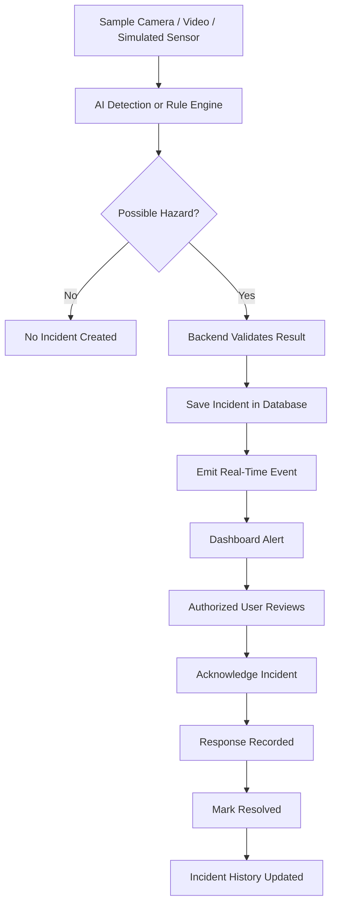
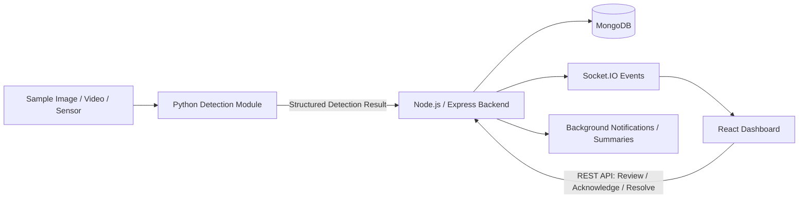

# SafeGuard AI
### Industrial Safety – Factory Incident Monitoring
**Tagline:** Detect Early. Respond Faster. Protect Every Worker.

> SafeGuard AI is a hackathon prototype that analyzes sample camera images/videos or simulated sensor readings, identifies possible factory safety hazards, records incidents, and helps authorized personnel respond through alerts and an acknowledgement workflow.

## Table of Contents
- [Overview](#overview)
- [Problem Statement](#problem-statement)
- [Objectives](#objectives)
- [Features](#features)
- [Workflow](#workflow)
- [Technology Stack](#technology-stack)
- [Architecture](#architecture)
- [Team Responsibilities](#team-responsibilities)
- [Modules and Data Model](#modules-and-data-model)
- [Suggested APIs](#suggested-apis)
- [Real-Time Events](#real-time-events)
- [Roles and Permissions](#roles-and-permissions)
- [Suggested Repository Structure](#suggested-repository-structure)
- [Setup Guide](#setup-guide)
- [Demo Guide](#demo-guide)
- [Testing Checklist](#testing-checklist)
- [Limitations and Safety](#limitations-and-safety)
- [Future Enhancements](#future-enhancements)
- [Contributors](#contributors)

---

## Overview

Factories contain multiple work areas, workers, machines, and monitoring devices. Safety risks such as missing personal protective equipment (PPE), smoke, or fire may occur in these areas. Manual monitoring can miss an incident or delay a response.

SafeGuard AI is designed to demonstrate how sample visual input or simulated sensor readings can be analyzed to identify selected possible hazards. When a possible hazard is detected, the backend creates an incident record and notifies connected dashboard users. Authorized personnel can review, acknowledge, and mark the incident as resolved.

This is a hackathon prototype using supplied, public, or synthetic data. It is not a certified industrial safety system.

## Problem Statement

**Industrial Safety – Factory Incident Monitoring**

Build a prototype that helps factory teams detect hazards early and respond faster.

The system should:
- Represent factories, zones, monitoring devices, workers, and incidents.
- Identify selected safety risks from sample visual input or simulated sensor input.
- Record incidents with their location, time, type, and acknowledgement status.
- Provide a clear alert and response workflow.

### Target risks
- A worker apparently not wearing required PPE, such as a safety helmet or safety jacket.
- Possible smoke or fire in a monitored/restricted area.
- Simulated sensor conditions crossing a configured safety threshold.

The actual detections depend on the model, sample data, and rules implemented by the team.

## Objectives

1. Organize factory information into factories, zones, devices, workers, and incidents.
2. Accept sample camera images/videos or simulated sensor readings.
3. Identify selected risks using computer vision, a pre-trained model, or configurable rules.
4. Create incident records containing relevant details.
5. Notify dashboard users when incidents are created or updated.
6. Allow authorized users to acknowledge incidents and record resolution.
7. Keep immediate incident recording separate from background notifications, summaries, and analytics.
8. Apply role-based access for operators, safety officers, and administrators.

## Features

### 1. Factory and zone representation
Represent a factory and its work areas. Associate monitoring devices with zones so each incident can be traced to a location.

### 2. Camera and sensor input
The prototype can accept sample images/video clips for visual analysis and simulated sensor values for rule-based detection. A live CCTV connection is not required.

### 3. AI-assisted hazard detection
A computer-vision module may analyze sample frames for supported conditions, such as missing helmet, missing safety jacket, or possible smoke/fire. A configurable rule may also create a simulated incident when a sensor reading crosses a threshold.

### 4. Incident management
Store each detected or simulated incident with its type, location, detection time, severity, status, and available evidence.

### 5. Real-time dashboard alerts
Push new incident notifications and status changes to connected dashboard clients. The dashboard must also be able to fetch the latest incident records from the backend.

### 6. Acknowledge and resolve
An authorized user can acknowledge an alert to indicate it has been seen. After the response is recorded, an authorized user can mark it resolved.

**Acknowledged is not the same as resolved:** acknowledgement means the alert has been seen; resolution means the response has been completed or recorded as complete.

### 7. Role-based access
Provide different permissions for operators, safety officers, and admins. Enforce permissions on the backend, not only by hiding UI buttons.

### 8. Incident history and summaries
Display incident history and useful filters such as status, type, zone, or date. Basic summary cards or charts can show counts by category and status.

## Workflow

1. **Input:** Submit a sample image/video frame or simulated sensor reading.
2. **Analysis:** The detection module analyzes the input using a model or configured rule.
3. **Detection result:** Return a structured category such as `missing_helmet`, `smoke_detected`, or `fire_detected`.
4. **Incident creation:** The backend validates the result and stores an incident with factory, zone, device, time, and evidence details.
5. **Notification:** The backend emits a real-time event to connected dashboards. Summaries and analytics can run asynchronously.
6. **Review:** An authorized user opens the incident and reviews its details/evidence.
7. **Acknowledgement:** The user acknowledges the incident.
8. **Resolution:** After the response is recorded, an authorized user marks it resolved.
9. **History:** The updated record remains available in incident history.



## Technology Stack

The following is the team's **proposed implementation stack**, not a requirement that every technology must be used.

| Layer | Proposed technology | Purpose |
|---|---|---|
| Frontend | React.js | Monitoring dashboard and user interface |
| Backend | Node.js + Express.js | REST APIs and application logic |
| Database | MongoDB | Store users, factories, zones, devices, and incidents |
| AI/ML | Python + suitable pre-trained model (e.g. YOLO) | Visual hazard detection |
| Image processing | OpenCV | Read and prepare image/video frames |
| Real-time communication | Socket.IO | Live incident and status updates |
| Authentication | JWT | Authentication for protected APIs |
| Charts (optional) | Recharts | Incident summaries |

Use compatible dependency versions and document the actual versions selected by the team.

## Architecture



**Component responsibilities**
- **Detection module:** Processes sample input and returns a structured possible-hazard result.
- **Backend:** Validates results, applies application rules, stores incidents, checks permissions, and exposes APIs.
- **Database:** Persists incident and related factory information.
- **Real-time layer:** Sends incident/status updates to connected dashboard clients.
- **Frontend:** Displays incident information and authorized response actions.
- **Background tasks:** Handle non-critical notifications, summaries, and analytics without delaying incident recording.

## Team Responsibilities

The team has four members. This is the proposed division of work for the prototype.

### Subham — Team Lead, Backend, and Integration
**Main responsibility:** Build the backend foundation and integrate all modules.

Tasks:
- Coordinate the team and integration schedule.
- Set up Node.js and Express.
- Design MongoDB models for users, factories, zones, devices, workers, and incidents as required.
- Implement APIs to receive detection results and retrieve incident records.
- Implement incident creation, update, acknowledgement, and resolution logic.
- Set up authentication and coordinate role-based authorization.
- Define request/response formats for the AI and frontend modules.
- Integrate the detection module, dashboard, and real-time events.
- Prepare sample data and help maintain the end-to-end demo.

**Deliverables:** Running backend, database connection/models, working incident APIs, shared API contract, sample data, and integrated prototype.

### Swarup — AI/ML and Computer Vision
**Main responsibility:** Analyze sample visual inputs and return possible hazard detections.

Tasks:
- Set up Python and OpenCV.
- Evaluate a suitable pre-trained model for the selected detections.
- Work on helmet and safety-jacket detection where supported by the chosen model.
- Explore smoke/fire detection for available sample data.
- Process sample images or video frames.
- Return structured output to the backend, including category and confidence when available.
- Provide annotated output/evidence for the dashboard.
- Test multiple examples and document false positives, missed detections, and limitations.

**Deliverables:** Runnable detection module, sample inputs, structured results, annotated example output, and model limitation notes.

### Rahul — Frontend and Dashboard
**Main responsibility:** Build the monitoring and incident-management user interface.

Tasks:
- Set up the React application.
- Build login and dashboard layouts.
- Display summary cards for incident counts/statuses.
- Build an incident list showing type, zone, time, severity, and status.
- Build an incident detail view with available evidence.
- Add filters for type, status, zone, or date where practical.
- Connect the UI to backend REST APIs.
- Display real-time updates from the event layer.
- Make the dashboard clear and usable during the demo.

**Deliverables:** React dashboard, incident list/detail, summary cards or charts, alert/status indicators, and API-connected frontend.

### Swayam — Alerts, Response Workflow, and Testing
**Main responsibility:** Ensure alerts reach users clearly and the response workflow is reliable.

Tasks:
- Coordinate Socket.IO event names and payload formats with Subham.
- Listen for new incident and update events in the dashboard.
- Display clear alerts for newly created incidents.
- Implement or coordinate acknowledge/resolve actions with Rahul and Subham.
- Ensure only authorized roles can perform protected actions.
- Clearly distinguish acknowledgement from resolution.
- Prevent duplicate event delivery from creating duplicate UI records.
- Test browser disconnect/reconnect behavior.
- After reconnecting, fetch the latest incidents from the API because events may have been missed.
- Test invalid requests, permission failures, and status updates.
- Prepare repeatable test cases and the demo checklist.

**Deliverables:** Real-time alert flow, acknowledge/resolve workflow, permission/failure test checklist, and repeatable demo cases.

**Important:** Socket.IO is the live-update channel; the database and backend APIs remain the source of truth. On reconnect, the client should fetch the latest incident records.

## Modules and Data Model

### Main modules

| Module | Responsibility | Main owner |
|---|---|---|
| Authentication and roles | Login and permission checks | Subham; Swayam tests |
| Factory/zone data | Factory, zone, and device context | Subham |
| Detection engine | Analyze sample visual input | Swarup |
| Incident API/database | Create and retrieve incidents | Subham |
| Dashboard | Display incidents and summaries | Rahul |
| Real-time alerts | Push incident/status events | Swayam |
| Response workflow | Acknowledge and resolve | Swayam with Subham/Rahul |
| Integration and demo | End-to-end testing/presentation | All |

### Suggested Incident document

This is a suggested starting schema; adapt it to the final implementation.

```json
{
  "_id": "unique-incident-id",
  "factoryId": "factory-001",
  "zoneId": "zone-A",
  "deviceId": "camera-01",
  "incidentType": "missing_helmet",
  "severity": "high",
  "detectedAt": "2026-11-13T10:30:00.000Z",
  "confidence": 0.91,
  "evidenceUrl": "optional-sample-evidence-reference",
  "status": "DETECTED",
  "acknowledgedBy": null,
  "acknowledgedAt": null,
  "resolvedBy": null,
  "resolvedAt": null
}
```

### Related entities to represent
- **Factory:** Factory identity and basic details.
- **Zone:** A work area belonging to a factory.
- **Device:** Camera or simulated sensor associated with a zone.
- **Worker:** A worker record if needed for the prototype; avoid unnecessary personal data.
- **User:** Login identity, role, and account status.
- **Incident:** Detected/simulated event and its response status.

Use consistent IDs to connect records. Store timestamps consistently (preferably UTC in the backend) and format them for local display in the frontend.

## Suggested APIs

These endpoint names are proposed to help team coordination. The final routes can differ.

| Method | Endpoint | Purpose |
|---|---|---|
| `POST` | `/api/incidents` | Receive detection result and create incident |
| `GET` | `/api/incidents` | Retrieve incidents, optionally filtered |
| `GET` | `/api/incidents/:id` | Retrieve one incident |
| `PATCH` | `/api/incidents/:id/acknowledge` | Acknowledge an incident |
| `PATCH` | `/api/incidents/:id/resolve` | Mark an incident resolved |
| `GET` | `/api/factories` | Retrieve factories |
| `GET` | `/api/zones` | Retrieve zones |
| `GET` | `/api/devices` | Retrieve monitoring devices |

### Example create-incident request

```json
{
  "factoryId": "factory-001",
  "zoneId": "zone-A",
  "deviceId": "camera-01",
  "incidentType": "missing_helmet",
  "severity": "high",
  "confidence": 0.91,
  "evidenceUrl": "optional-sample-evidence-reference"
}
```

### Example response

```json
{
  "success": true,
  "message": "Incident created",
  "incident": {
    "id": "generated-incident-id",
    "incidentType": "missing_helmet",
    "status": "DETECTED"
  }
}
```

### API notes
- Validate required fields and allowed incident types.
- Derive permissions from the authenticated session/token; never trust a role supplied in the request body.
- Return suitable HTTP status codes and useful error messages.
- Protect acknowledgement and resolution endpoints with role checks.
- Keep the API contract consistent across backend, AI, and frontend.

## Real-Time Events

Suggested Socket.IO event names:

| Event | Meaning |
|---|---|
| `incident:created` | A new incident has been stored |
| `incident:updated` | Incident details have changed |
| `incident:acknowledged` | An incident has been acknowledged |
| `incident:resolved` | An incident has been resolved |

Event payloads should include the incident ID and the fields needed by the UI. Do not send secrets or unnecessary personal data.

**Reliability guidance**
- Save the incident before emitting its creation event.
- Treat the database/API as the source of truth.
- Handle repeated event delivery without duplicating incident records in the UI.
- Fetch current records after a client reconnects.
- Keep slow analytics and non-critical notifications outside the immediate incident-creation path.

## Roles and Permissions

The problem statement calls for operators, safety officers, and admins. The following matrix is a proposed starting point and should be confirmed by the team.

| Action | Operator | Safety Officer | Admin |
|---|---:|---:|---:|
| View dashboard | Yes | Yes | Yes |
| View incident details | Yes | Yes | Yes |
| Acknowledge incident | As configured | Yes | Yes |
| Resolve incident | As configured | Yes | Yes |
| Manage users/configuration | No | As configured | Yes |

Enforce permissions on the backend, not only by hiding frontend buttons.

## Suggested Repository Structure

One possible layout for the proposed React + Node + Python stack:

```text
safeguard-ai/
├── frontend/                  # React dashboard
│   ├── public/
│   └── src/
│       ├── components/
│       ├── pages/
│       ├── services/           # API and Socket.IO clients
│       ├── hooks/
│       └── App.jsx
├── backend/                   # Node.js + Express API
│   ├── src/
│   │   ├── config/
│   │   ├── models/
│   │   ├── controllers/
│   │   ├── routes/
│   │   ├── middleware/
│   │   ├── services/
│   │   └── server.js
│   └── package.json
├── ai-module/                 # Python + OpenCV + detection model
│   ├── samples/
│   ├── outputs/
│   ├── detector.py
│   └── requirements.txt
├── docs/                      # Architecture, API notes, screenshots
├── .gitignore
└── README.md
```

This is a suggested layout, not a claim that these files already exist. Adapt it to the actual repository.

## Setup Guide

> These are suggested setup commands for the proposed stack. They become runnable once the team creates the matching folders, package files, scripts, and dependencies.

### Prerequisites
- Git
- Node.js and npm
- Python 3
- MongoDB local instance or MongoDB connection URI
- Code editor
- Sample images/videos for testing

### 1. Clone the repository

```bash
git clone <YOUR_REPOSITORY_URL>
cd safeguard-ai
```

Replace the placeholder with the actual repository URL.

### 2. Backend setup

```bash
cd backend
npm install
```

Create the backend `.env` file (example below), then run the script defined in `package.json`. If the project defines a `dev` script:

```bash
npm run dev
```

### 3. Frontend setup

In a separate terminal:

```bash
cd frontend
npm install
npm run dev
```

Use the script configured in the frontend `package.json`.

### 4. AI module setup

```bash
cd ai-module
python -m venv .venv
```

Activate the virtual environment:

**Windows PowerShell**
```powershell
.venv\Scripts\Activate.ps1
```

**macOS / Linux**
```bash
source .venv/bin/activate
```

Install dependencies after creating `requirements.txt`:

```bash
pip install -r requirements.txt
```

Document the selected model, model weights, and exact detector run command when the AI module is finalized.

## Configuration

Never commit real passwords, access tokens, database credentials, or private keys to Git.

### Backend `.env` example

```env
PORT=5000
MONGODB_URI=mongodb://127.0.0.1:27017/safeguard_ai
JWT_SECRET=replace_with_a_long_random_secret
CLIENT_URL=http://localhost:5173
```

These are local-development examples. Use a strong secret and the correct database URI for your environment.

### Frontend environment example (Vite)

```env
VITE_API_BASE_URL=http://localhost:5000
```

Only expose non-secret configuration in frontend variables. Never put database credentials or JWT signing secrets in frontend code.

## Demo Guide

A repeatable hackathon demo can follow these steps:

1. Open the dashboard and sign in with a demo account.
2. Show the factory and zone context.
3. Submit a prepared sample image/video frame or simulated sensor reading.
4. Show the detection result returned by the AI/rule module.
5. Show the newly created incident on the dashboard.
6. Open the incident and show its type, zone, time, severity, and evidence (if available).
7. Use an authorized safety-officer/admin account.
8. Acknowledge the incident and show the updated status.
9. Mark it resolved and show the updated incident history.
10. Explain the detection limitations and clarify that this is a prototype.

Use prepared sample data so the demonstration is repeatable and does not depend on an actual factory camera or real emergency.

## Testing Checklist

### Detection
- [ ] Supported sample image/video can be submitted.
- [ ] Detection module returns a structured result.
- [ ] A no-detection example does not create an incident.
- [ ] Invalid/unsupported input is handled safely.
- [ ] Confidence/evidence is shown only when available.
- [ ] Known detection limitations are documented.

### Backend and database
- [ ] Valid incident can be created and stored.
- [ ] Required fields are validated.
- [ ] Incident list and detail APIs return expected records.
- [ ] Invalid IDs and malformed requests return useful errors.
- [ ] Acknowledgement and resolution update the database.
- [ ] Duplicate submissions/events are handled appropriately.

### Frontend and real-time alerts
- [ ] Dashboard loads incidents from the API.
- [ ] New incident appears when its event is received.
- [ ] Status changes appear in the dashboard.
- [ ] Loading, empty, and error states are handled.
- [ ] Reconnecting fetches the latest incident records.

### Security and permissions
- [ ] Protected routes require authentication.
- [ ] Unauthorized users cannot acknowledge/resolve incidents.
- [ ] Admin-only operations are protected.
- [ ] Secrets are not committed to the repository.

### Demo readiness
- [ ] Sample inputs are available.
- [ ] Demo accounts and roles are ready.
- [ ] Backend, frontend, and AI module run successfully.
- [ ] Full input-to-resolution workflow has been tested.
- [ ] Backup screenshots or recording are available.

## Limitations and Safety

- This is a hackathon prototype, not a certified or production-ready industrial safety system.
- A detection is an indication of a **possible** hazard, not confirmation of a real-world incident.
- Computer-vision models can produce false positives and false negatives. Results depend on lighting, camera angle, image quality, distance, occlusion, sample data, and the selected model.
- Smoke/fire detection from ordinary images can be uncertain. Explain clearly what the selected model can and cannot detect.
- Use only supplied, public, or synthetic sample data for the prototype.
- Do not connect the prototype to or control actual factory safety equipment, machinery, alarms, or emergency systems.
- Do not use it as a substitute for trained safety personnel, approved procedures, or certified detection equipment.
- Protect sample data and avoid collecting unnecessary personal information about workers.

## Future Enhancements

Possible future work beyond the minimum prototype:
- Support more PPE categories.
- Add more factory zones and simulated monitoring devices.
- Add configurable sensor thresholds and sensor history.
- Evaluate the model on a larger, appropriately licensed dataset.
- Add incident export and reporting.
- Add optional email notifications with safe configuration.
- Add audit logs for user actions.
- Add analytics by zone, incident type, and time.
- Improve deployment, monitoring, and automated tests.

These are future ideas, not claims that the features are already implemented.

## Contributors

| Name | Responsibility |
|---|---|
| **Subham** | Team Lead, Backend, and System Integration |
| **Swarup** | AI/ML and Computer Vision |
| **Rahul** | Frontend and Dashboard |
| **Swayam** | Alerts, Response Workflow, and Testing |

## Project Status

**Status:** Hackathon prototype — in development.

Update this section as modules are implemented and tested. Do not mark a feature complete until it works.

- [ ] Repository and project folders created
- [ ] Backend and database connected
- [ ] Incident APIs implemented
- [ ] AI/rule detection works on sample inputs
- [ ] Dashboard displays incident records
- [ ] Real-time events work
- [ ] Acknowledge and resolve workflow works
- [ ] Role permissions tested
- [ ] End-to-end demo completed
- [ ] Final documentation and screenshots added

---

**SafeGuard AI — Detect Early. Respond Faster. Protect Every Worker.**
